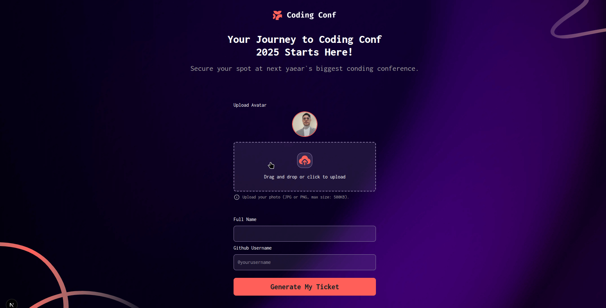

# Frontend Mentor Challenges 🎨🚀

Este repositório reúne as minhas resoluções dos desafios do [Frontend Mentor](https://www.frontendmentor.io/).

## 📌 Desafios Concluídos

| Desafio | Tecnologias | Demo / Deploy |
| :--- | :--- | :--- |
| **01. Order Summary Card** | Next.js, Tailwind CSS | [Ver Projeto](https://order-summary-card-one.vercel.app/) |
| **02. Huddle Landing Page** | Next.js, Tailwind CSS | [Ver Projeto](https://huddle-landing-page-indol-six.vercel.app/) |
| **03. Conference Ticket Generator** | Next.js, TypeScript, Tailwind CSS, React Hooks | [Ver Projeto](https://frontend-mentor-challenge-bice.vercel.app/) |

---

## 🎯 Desafio em Destaque: Conference Ticket Generator

### 📸 Captura de Ecrã

### 🔗 Links Oficiais

- **Repositório do projeto:** [frontend-mentor-challenge](https://github.com/FelipeGdasilva/frontend-mentor-challenge)
- **Pasta do componente:** [`/conference-ticket-generator`](./conference-ticket-generator)
- **Ver Projeto ao Vivo (Vercel):** [Conference Ticket Generator Demo](https://frontend-mentor-challenge-bice.vercel.app/)

### 💡 O que aprendi

Durante o desenvolvimento deste projeto, aprofundei os meus conhecimentos em React e Next.js, com foco especial em:

- **Renderização Condicional:** Como alternar de forma limpa e fluida entre diferentes estados de componentes (o formulário e o cartão do bilhete de sucesso) com base no estado da aplicação.
- **Manipulação de Inputs e Uploads de Ficheiros:** Captura e tratamento de arquivos de imagem locais no browser utilizando `URL.createObjectURL` para renderizar pré-visualizações instantâneas de avatares.
- **Tipagem Estrita com TypeScript:** Utilização correta de `React.SubmitEvent` na manipulação do evento de envio do formulário, garantindo maior previsibilidade, prevenção do comportamento padrão com `preventDefault()` e tipagem segura do manipulador.
- **Layout Responsivo e Alinhamento com Tailwind:** Ajuste de espaçamentos complexos e posicionamento de elementos gráficos (como o cartão de bilhete personalizado) para que se adaptassem perfeitamente a diferentes tamanhos de ecrã sem quebrar a integridade do design.

### 🛠️ Desafios e Reflexão

Gestão bem-sucedida de uma estrutura modular em monorepositório no Next.js, manipulação segura de URLs de objetos de imagem dinâmicos no lado do cliente, e garantia de um alinhamento responsivo pixel-perfect alinhado com os padrões de design do Frontend Mentor em dispositivos móveis e computadores.

_Desenvolvido por Felipe._