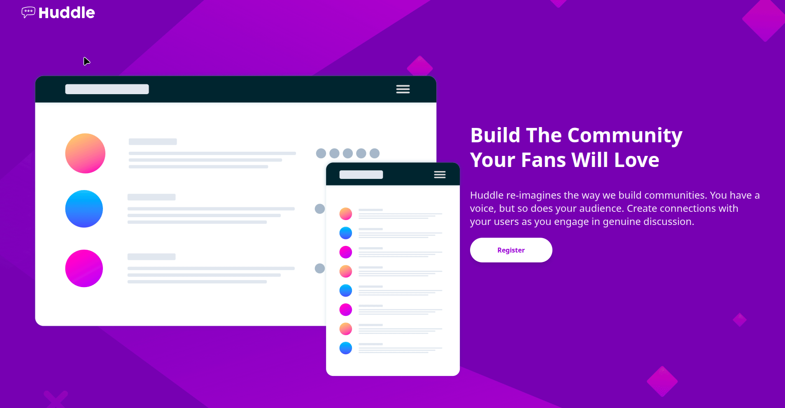

# Frontend Mentor Challenges 🎨🚀

Este repositório reúne as minhas resoluções dos desafios do [Frontend Mentor](https://www.frontendmentor.io/).

## 📌 Desafios Concluídos

| Desafio | Tecnologias | Demo / Deploy |
| :--- | :--- | :--- |
| **01. Order Summary Card** | Next.js, Tailwind CSS | [Ver Projeto] (https://order-summary-card-one.vercel.app/ )|
| **02. Huddle Landing Page** | Next.js, Tailwind CSS | [Ver Projeto] (https://huddle-landing-page-indol-six.vercel.app/)|

---

---

## 🎯 Desafio em Destaque: Huddle Landing Page

### 📸 Screenshot

### 🔗 Links Oficiais
- **Desafio no Frontend Mentor:** [Huddle Landing Page Challenge](https://www.frontendmentor.io/challenges/huddle-landing-page-with-a-single-introductory-section-3_22UStandard)
- **Ver Projeto ao Vivo (Vercel):** [Huddle Landing Page Demo](https://huddle-landing-page-indol-six.vercel.app/)

### 💡 What I Learned
In this challenge, I built a two-column responsive layout using **Tailwind CSS Grid** and **Flexbox**. Key takeaways:
- Configured hover and focus interactive states for buttons and social icons.
- Built a mobile-first responsive structure that seamlessly switches to a 12-column grid layout on desktop.
- Deployed through Vercel using Root Directory settings within a monorepo setup.

### 🛠️ Challenges & Reflection
Structuring layouts cleanly in Next.js while keeping each Frontend Mentor challenge modular inside a monorepo repository.

*Desenvolvido por Felipe.*