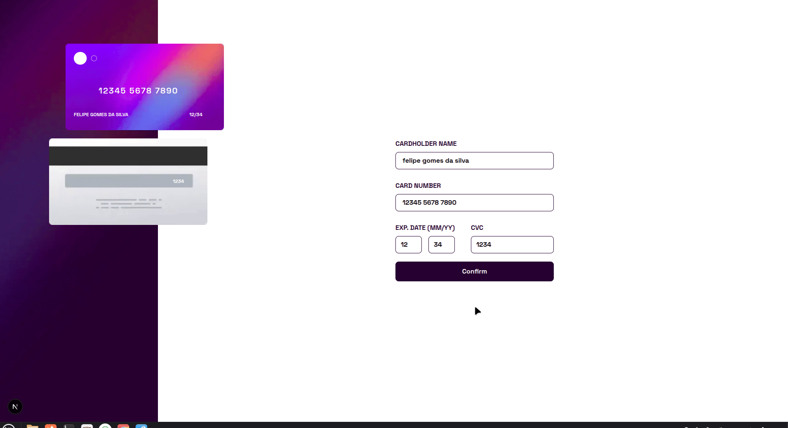

# Frontend Mentor Challenges 🎨🚀

Este repositório reúne as minhas resoluções dos desafios do [Frontend Mentor](https://www.frontendmentor.io/).

## 📌 Desafios Concluídos

| Desafio | Tecnologias | Demo / Deploy |
| :--- | :--- | :--- |
| **01. Order Summary Card** | Next.js, Tailwind CSS | [Ver Projeto](https://order-summary-card-one.vercel.app/) |
| **02. Huddle Landing Page** | Next.js, Tailwind CSS | [Ver Projeto](https://huddle-landing-page-indol-six.vercel.app/) |
| **03. Conference Ticket Generator** | Next.js, TypeScript, Tailwind CSS, React Hooks | [Ver Projeto](https://frontend-mentor-challenge-bice.vercel.app/) |
| **04. Interactive Card Details Form** | Next.js, TypeScript, Tailwind CSS, React Hooks | [Ver Projeto](https://interactive-card-details-one-murex.vercel.app/) |

---

## 🎯 Desafio em Destaque: Interactive Card Details Form

### 📸 Captura de Ecrã

### 🔗 Links Oficiais

- **Repositório do projeto:** [frontend-mentor-challenge](https://github.com/FelipeGdasilva/frontend-mentor-challenge)
- **Pasta do componente:** [`/interactive-card-details`](./interactive-card-details)
- **Ver Projeto ao Vivo (Vercel):** [Interactive Card Details Form Demo](https://interactive-card-details-one-murex.vercel.app/)

### 💡 O que aprendi

Durante o desenvolvimento deste projeto, aprofundei a organização de formulários e validações em React e TypeScript, com foco especial em:

- **Validação Modularizada:** Centralização da configuração dos campos em `createCardFields`, mantendo a lógica limpa, legível e fácil de manter.
- **Sanitização e Normalização de Entradas:** Uso de `.trim()` para evitar envios vazios ou compostos apenas por espaços e `.replaceAll(" ", "")` para normalizar o número do cartão antes da checagem numérica.
- **Validação de Formato e Tipagem:** Aplicação de regex (`/^\d+$/`) nos campos numéricos e tipagem de erros com `Partial<Record<...>>` para exibir mensagens claras por campo.
- **Acessibilidade em Formulários:** Conexão de `<label>` com `htmlFor` e `id` nos inputs, garantindo boa usabilidade e semântica acessível.

### 🛠️ Desafios e Reflexão

Estruturação de validação de formulário sem excesso de abstrações, alinhamento consistente de estados e tipos no TypeScript e garantia de acessibilidade entre rótulos e campos de entrada.

_Desenvolvido por Felipe._