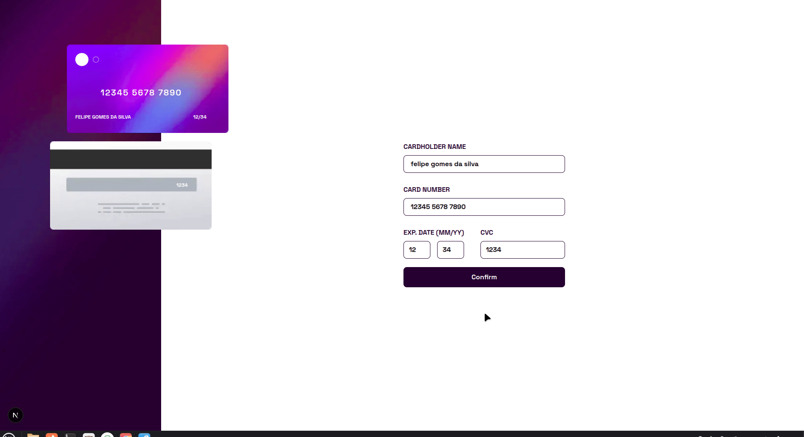

# Interactive Card Details Form

Solução para o desafio **Interactive Card Details Form** do Frontend Mentor, construída com React, Next.js e TypeScript.

## Demonstração

<!-- Substitua o caminho abaixo pelo seu GIF quando gravar -->


## Funcionalidades e lógica

* **Validação modularizada:** configuração dos campos separada em `createCardFields`, mantendo o formulário limpo e reutilizável.
* **Sanitização de entrada:** uso de `.trim()` para evitar envios vazios ou apenas com espaços, e `.replaceAll(" ", "")` para normalizar espaços no número do cartão antes da validação numérica.
* **Feedback de erros por campo:** controle tipado de mensagens de erro para campos em branco e formato numérico inválido (`/^\d+$/`).
* **Acessibilidade:** associação de `<label>` com `htmlFor` e `id` nos inputs, além de rótulo descritivo no campo de ano.

## Tecnologias utilizadas

* Next.js (App Router)
* React
* TypeScript
* Tailwind CSS

## Como rodar o projeto

```bash
npm install
npm run dev
```

Abra `http://localhost:3000` no navegador para visualizar.