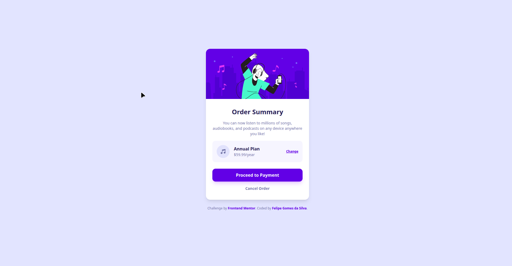

# Frontend Mentor - Order Summary Component Solution

Esta é uma solução para o desafio [Order Summary Component do Frontend Mentor](https://www.frontendmentor.io/challenges/order-summary-component-QlP2Ro535). Os desafios do Frontend Mentor ajudam a aprimorar habilidades práticas construindo projetos reais.

## 📝 Sumário

- [Visão Geral](#visão-geral)
  - [O Desafio](#o-desafio)
  - [Screenshot](#screenshot)
  - [Links](#links)
- [Meu Processo](#meu-processo)
  - [Tecnologias Utilizadas](#tecnologias-utilizadas)
  - [O que aprendi](#o-que-aprendi)
- [Autor](#autor)

---

## 🚀 Visão Geral

### O Desafio

Os usuários devem ser capazes de:

- Visualizar o layout ideal para o componente dependendo do tamanho da tela do dispositivo (Responsivo).
- Ver estados de hover para todos os elementos interativos na página.

### Screenshot

*(Dica: substitua o caminho acima por uma imagem ou GIF do seu projeto rodando!)*

### Links

- **URL do Repositório:** https://github.com/FelipeGdasilva/Order-summary-card
- **URL do Site (Deploy Vercel):** https://order-summary-card-one.vercel.app/

---

## 🛠️ Meu Processo

### Tecnologias Utilizadas

- **[Next.js](https://nextjs.org/)** - React Framework para produção
- **[TypeScript](https://www.typescriptlang.org/)** - Tipagem estática
- **[Tailwind CSS](https://tailwindcss.com/)** - Estilização utility-first
- **Flexbox** - Layout e alinhamento de componentes
- **Next Font (`next/font/google`)** - Otimização da fonte Red Hat Display

### O que aprendi

Neste projeto, consolidei a transição do CSS tradicional para a estilização ágil com **Tailwind CSS**, focando na criação de componentes responsivos e alinhamentos precisos.

Alguns aprendizados chave:

1. **Alinhamento e Flexbox com Tailwind:**
   Uso de `flex items-center justify-between` para estruturar sub-cards internos (como a caixa do plano com o botão de alteração) e `text-left` para redefinir o alinhamento de texto herdado do container pai.

2. **Estilização de Estados Interativos:**
   Aplicação de transições suaves e cores personalizadas nos botões e links usando classes como `hover:bg-[#766cf1]` e `hover:underline`.

3. **Boas Práticas de Layout:**
   Construção de espaçamentos verticais responsivos utilizando `py-*` e `gap-*` em containers internos, mantendo as imagens coladas às bordas do card principal sem quebrar a responsividade.

---

## 👨‍💻 Autor

- **LinkedIn:** www.linkedin.com/in/felipe-gomes-silva-dev/
- **Frontend Mentor:** https://www.frontendmentor.io/profile/FelipeGdasilva
- **GitHub:** https://github.com/FelipeGdasilva